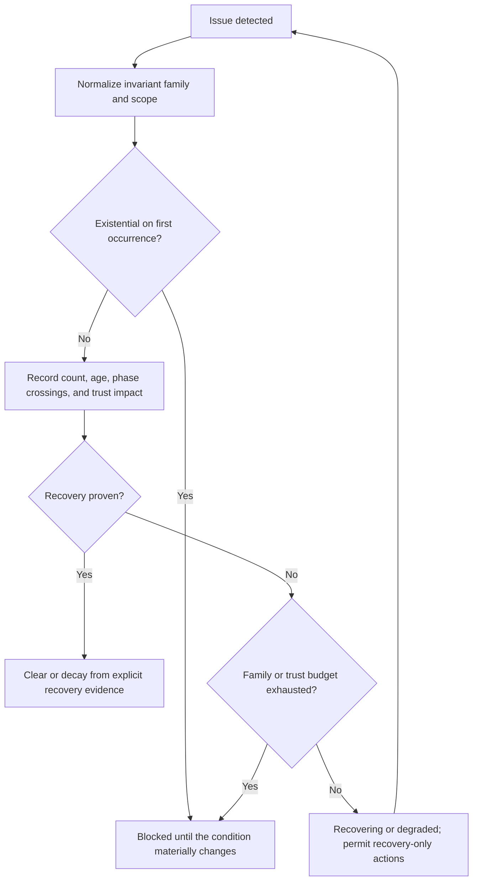

# Codex Operating-Contract Control Design

**Status:** In review  
**Workstream:** `state://gpt-meta-mechanics/019f9380-daee-7672-bdab-84f763eb2874`  
**Writer:** Codex thread `019f9380-daee-7672-bdab-84f763eb2874`  
**Last updated:** 2026-07-25  
**Implementation gate:** Closed until James approves the complete design and reviews the committed specification.

## Artifact Policy

This document preserves the complete design record, not only the current recommendation.

- Approved work remains marked `Approved`.
- Work awaiting review remains marked `Pending`.
- Rejected work remains present with the reason it was rejected.
- Deferred work remains present with a concrete revisit trigger.
- Replaced work is marked `Superseded` and points to the replacing proposal.
- New evidence may change a status, but prior rationale is not silently deleted.
- Unapproved material is explicitly non-authoritative and cannot open the implementation gate.

The working draft remains uncommitted while design review is active. After the complete design is approved, it will be self-reviewed, committed, and presented to James for final written-spec review.

## Purpose

Design how Codex hook and extension primitives should support the operating contract without pretending that mechanical validation can prove semantic compliance.

The design has two linked outcomes:

1. Make compaction recovery deterministic from per-thread durable state.
2. Stop globally viral skill routing while preserving task-relevant skills for later, selective integration.

## Definition of Done

The design is complete when James has approved, and the repository contains a reviewed specification for:

- the canonical thread-state path;
- scope and source precedence;
- pre-compaction checkpointing and post-compaction rehydration;
- operating-contract snapshot and registry semantics;
- task-specific, non-propagating skill routing;
- hook and extension ownership boundaries;
- failure classification, accumulation, recovery, and escalation;
- verification and rollout strategy.

Implementation planning begins only after this specification is complete, self-reviewed, committed, and approved.

## Review Ledger

| Section | Status | Review note |
| --- | --- | --- |
| Canonical thread-state path | Approved | James selected path shape A. |
| Guarded checkpoint and mandatory rehydration | Approved | Prompt guidance is supporting context; direct runtime injection remains the stronger later target. |
| Control-layer boundary | Approved in principle | Hooks enforce payload-aware mechanics, extensions own deterministic integration, and the model retains semantic judgment. |
| Tiered failure policy with accumulation | Approved | James selected tiered enforcement and required accumulation-aware escalation. |
| Cross-contract hook map | Pending review | Next design section. |
| End-to-end data flow and ownership | Pending review | Follows hook-map approval. |
| Selective skill-routing boundary | Pending review | Must remain non-propagating. |
| Verification and rollout | Pending review | Final design section before specification completion. |

## Proposal Status Vocabulary

| Status | Meaning |
| --- | --- |
| `Approved` | James accepted the proposal as part of the design. |
| `Pending` | Proposed or identified, but not yet reviewed or accepted. |
| `Rejected` | Considered and intentionally excluded; rationale and revisit conditions remain recorded. |
| `Deferred` | Potentially valuable but outside the current implementation slice; includes a revisit trigger. |
| `Superseded` | Replaced by a later proposal; retained for provenance. |

## Proposal Ledger

| ID | Proposal | Status | Rationale or disposition | Revisit trigger |
| --- | --- | --- | --- | --- |
| P1 | Canonical path `~/.codex/.workstreams/<thread-id>/WORKSTREAM-STATE.md` | Approved | Deterministic first lookup with thread identity in the path and logical identity inside the record. | Revisit only if Codex introduces a stronger host-owned thread-state adapter. |
| P2 | Guarded pre-compaction checkpoint plus mandatory rehydration | Approved | Prevents replacement context from silently initializing a new workstream. | Revalidate when compaction lifecycle ordering changes. |
| P3 | Prompt-only compaction fix | Rejected | The active token-budget and remote-v2 paths do not make the configurable compaction prompt a reliable checkpoint mechanism. | Revisit if every active compaction path guarantees the prompt and a durable write capability. |
| P4 | Direct runtime injection of verified thread state into each new context | Deferred | Stronger than prompt-mediated rehydration, but requires a Codex runtime integration. | Revisit after the state resolver and immediate guarded lifecycle are stable. |
| P5 | Central severity-and-accumulation evaluator | Approved | Provides consistent classification and cross-hook accumulation. | Revalidate against the final hook map and extension ownership model. |
| P6 | Independent retry and block budgets inside each hook | Rejected | Equivalent failures can evade escalation across hooks and lifecycle stages. | Revisit only for local emergency stops that still consult the shared policy. |
| P7 | Full append-only incident ledger | Deferred | Strong auditability, but too much persistence and retention machinery for the first slice. | Revisit when operational postmortems or cross-session trend analysis justify it. |
| P8 | Family accumulation plus cross-family trust accumulation | Approved | Captures both repeated symptoms and collectively untrustworthy clusters of temporary failures. | Revisit when concrete budgets are calibrated from verification results. |
| P9 | Cross-contract hook and extension map | Pending | Required to assign detection, enforcement, recovery, and blocking ownership. | Current next review section. |
| P10 | Integrate selected Superpowers capabilities into the unified tool | Deferred | Useful capabilities should remain available, but routing must first become task-specific and non-propagating. | Revisit after the state resolver and routing boundary are stable. |
| P11 | Exact per-family retry counts, windows, and trust thresholds | Pending | The policy semantics are approved, but numeric budgets depend on lifecycle ownership and failure cost. | Resolve during the hook map and verification sections. |

## Proposal Change Protocol

When a proposal changes:

1. Retain the original proposal row.
2. Change its status to `Superseded`, `Rejected`, or `Deferred`.
3. Record the reason and the proposal that replaces it.
4. Add the replacement as a new proposal ID.
5. Reflect approved material changes in the revisioned workstream state.

Conversation summaries may be concise, but the artifact must retain the inspectable reasoning needed to revisit an earlier branch.

## Current Decisions

### State and compaction

- Use `~/.codex/.workstreams/<thread-id>/WORKSTREAM-STATE.md` as the mandatory first state lookup.
- Keep the logical Workstream ID, writer binding, ancestry, revision, and persistence metadata inside that thread-keyed record.
- Resolve project and global sources deterministically by proximity, but never let them silently replace the thread's mutable state owner.
- Compaction recovery resumes the existing workstream; it does not initialize a replacement.
- Use token-budget guidance and an early semantic-checkpoint reminder as supporting context.
- Use `PreCompact` for mechanical checkpoint validation and recovery-capsule creation.
- Use fresh initial-context construction for mandatory rehydration.
- Treat direct runtime injection of verified thread state into every new context window as the stronger later integration target.
- Do not rely on `compact_prompt` as the primary mechanism. The active token-budget path does not use it, and the active remote-v2 path does not consume it either.

### Skills

- Skill routing must be task-specific and non-propagating.
- An invoked skill must not make its own broad trigger rules automatically authoritative for later unrelated turns.
- Future integration of selected Superpowers capabilities is separate from the immediate recovery and routing fix.

### Control layers

The design uses three control layers with deliberately different authority:

1. **Hooks:** Payload-aware mechanical gates and evidence producers.
2. **Typed extensions:** Deterministic state/context integration and bounded runtime health state.
3. **Model judgment:** Semantic contract behavior that cannot be proven mechanically.

Hooks and extensions may require evidence, enforce structural invariants, inject recovery instructions, and block actions when a mechanical invariant fails. They must not claim that syntactic success proves truthfulness, adequate reasoning, correct tangent classification, or material progress.

## Approved Failure Policy

### Design goal

Failure handling uses two independent dimensions:

1. **Intrinsic failure class:** Whether the condition is recoverable or immediately invalidates authority, safety, identity, or durability.
2. **Accumulated unresolved evidence:** Repetition, age, lifecycle crossings, related failures, and absence of recovery evidence.

A recoverable problem can become existential through accumulation. An existential problem receives no ordinary retry budget unless the underlying authority or state materially changes.

### Selected architecture

Use one centralized severity-and-accumulation evaluator.

Hooks and extensions emit normalized issue signals. The evaluator owns classification, accumulation, recovery budgets, escalation, and clearing rules. Hooks remain detection and enforcement points; they do not independently invent incompatible retry policies.

The evaluator keeps a bounded summary in extension-owned thread state. The workstream record contains durable decisions and material blockers, not a high-volume event log.

### Alternatives considered

#### Independent per-hook budgets

Rejected as the governing architecture.

Advantages:

- Small initial implementation.
- Local behavior is easy to understand.

Disadvantages:

- Equivalent failures can receive separate budgets and evade escalation.
- Cross-hook and cross-stage accumulation is unreliable.
- Clearing and decay rules drift between handlers.
- A contract-bootstrap problem can appear as unrelated network, parser, registry, and rendering failures.

Local hooks may still perform emergency blocking after consulting the shared policy.

#### Full append-only incident ledger

Deferred as a possible observability extension.

Advantages:

- Strong auditability and postmortem support.
- Natural cross-session accumulation history.

Disadvantages:

- Adds persistence, retention, privacy, migration, corruption, and replay concerns before the recovery mechanism is stable.
- Encourages telemetry architecture beyond the immediate objective.

The initial design retains bounded health state and the latest material evidence instead.

## Failure States

| State | Meaning | Permitted activity |
| --- | --- | --- |
| `clear` | No unresolved material issue | Normal work |
| `recovering` | A recoverable issue is within a bounded retry or repair budget | Recovery, inspection, and narrowly necessary diagnostics |
| `degraded` | Failures are accumulating, crossing stages, or consuming the trust budget | Recovery-only actions; substantive mutations pause |
| `blocked` | An existential invariant failed or a recovery budget was exhausted | Only actions that can resolve the blocking authority, safety, identity, or durability condition |

This is not a single numeric health score. Unrelated cosmetic warnings must not add up mechanically to the same result as an authority-boundary failure.

## Issue Signal

Every mechanical detector should normalize its output into the same logical envelope:

| Field | Purpose |
| --- | --- |
| `family` | Stable invariant family used for accumulation |
| `code` | Specific symptom within the family |
| `intrinsic_class` | `recoverable` or `existential` |
| `scope` | Attempt, turn, compaction, thread, or external authority |
| `correlation_key` | Workstream, target, operation, or resource identity |
| `first_seen` | Beginning of the unresolved interval |
| `last_seen` | Most recent occurrence |
| `count` | Equivalent occurrences within the active budget |
| `phase_crossings` | Lifecycle boundaries crossed while unresolved |
| `recovery_action` | Bounded action permitted to resolve the issue |
| `recovery_evidence` | Evidence required before clearing or decaying it |
| `blocking_reason` | Inspectable explanation when effective state is `blocked` |

The concrete serialization format will be selected during implementation planning. This design fixes the semantics, not the encoding.

## Accumulation Channels

### Family accumulation

Aggregate repeated or equivalent symptoms within one invariant family.

Examples:

- `contract-bootstrap-integrity`
  - network retrieval failure;
  - truncated contract body;
  - header mismatch;
  - registry download failure;
  - registry digest mismatch;
  - scalar reconstruction failure.
- `workstream-authority`
  - missing canonical state;
  - Workstream ID mismatch;
  - writer conflict;
  - unexpected revision;
  - ambiguous recovery candidate.
- `workstream-durability`
  - write failure;
  - read-back failure;
  - checkpoint older than the semantic state being compacted.
- `tool-authority`
  - ungranted permission;
  - unresolved protected target;
  - disallowed input rewrite;
  - policy bypass attempt.

Changing the surface label does not create a new budget when the underlying invariant is the same.

### Trust accumulation

Aggregate multiple unresolved material families within the same bootstrap, turn, compaction, or thread phase.

This catches cases where each issue could be described as temporary in isolation, but their combination makes continued operation untrustworthy. For example, contract retrieval trouble plus ambiguous state recovery plus missing evidence capture should move the thread into `degraded` or `blocked` operation even if no individual family has exhausted its own retry count.

Trust accumulation must use explicit domain weights or deterministic rules. It must not become a vague model-generated health score.

## Immediate Existential Failures

These block on first occurrence:

- An action would cross an ungranted permission or authority boundary.
- A required operation cannot proceed because the necessary authority cannot be obtained.
- A mandatory workstream checkpoint cannot be written and verified before state loss or compaction.
- The persisted writer binding or revision conflicts with the active writer and cannot be reconciled safely.
- A destructive or externally consequential target cannot be resolved unambiguously.
- Compaction would destroy context without a valid checkpoint and rehydration path.
- Protected input was mutated or bypassed outside the authority granted to the responsible hook or extension.

Retry is permitted only after a material change, such as:

- James grants the required authority;
- storage becomes writable;
- the active writer conflict is resolved;
- the protected target becomes unambiguous;
- a verified checkpoint and rehydration path are established.

## Initially Recoverable, Accumulation-Sensitive Failures

These begin in `recovering` or `degraded`:

- transient contract or registry download failure;
- retrieval truncation or Unicode normalization;
- initial state lookup failure or ambiguity;
- transient parser, checksum-command, network, or tool-path failure;
- missing canary or response surface that can still be reconstructed from verified sources;
- malformed output from a non-critical advisory validator.

Their budgets are bounded. Repeated failures, failed alternate paths, growing ambiguity, lifecycle-boundary crossings, or arrival at a destructive transition without recovery escalate them to `blocked`.

Contract bootstrap failure is a useful example:

1. A first network or preview failure is recoverable.
2. The system retries through the cache-busted, byte-preserving path.
3. While recovery is in progress, substantive work remains paused.
4. Successful header, full-body, registry, digest, and scalar verification clears the issue.
5. Exhausted retrieval paths or persistent verification failure make trusted contract activation impossible and therefore existential.

## Semantic Findings

The following remain model judgments:

- truthfulness;
- whether a claim is adequately warranted;
- tangent, dependency, advance, and pivot classification;
- whether progress is materially meaningful;
- whether a state change is material;
- whether an assumption is load-bearing;
- whether a recommendation follows from the evidence.

Mechanical controls may:

- require relevant state or evidence to be present;
- detect missing structural elements;
- inject correction or recovery instructions;
- record unresolved semantic risk;
- prevent completion when the model reports an unresolved mandatory checkpoint.

Mechanical controls must not:

- declare a response truthful because it passed a formatter;
- declare a claim warranted because a marker is present;
- infer objective progress from token or tool activity;
- certify correct tangent handling from keywords alone.

## Recovery and Reset

An issue does not clear merely because time passes or a new turn starts.

Clearing or decay requires family-appropriate evidence:

- successful byte-preserving contract fetch plus header and registry verification;
- successful state read with matching Workstream ID, writer binding, revision, and location;
- successful state write followed by read-back;
- explicit permission or authority change;
- successful retry of the failing operation;
- explicit user resolution of ambiguity.

Recovery rules must distinguish:

- **clear:** the invariant is directly re-established;
- **decay:** confidence improves, but prior failures remain relevant within a bounded window;
- **supersede:** a new authority or state intentionally replaces the failed one;
- **remain blocked:** no material condition changed.

## Failure-State Transition

## Current Risks

- A semantic checkpoint must happen before automatic compaction begins.
- A failed `PreCompact` process does not automatically stop compaction; blocking requires supported structured output.
- `PostCompact` completion is an application event, not automatically model-visible context.
- Mid-turn compaction can continue sampling before queued rehydration hooks are dispatched.
- `Stop` must honor `stop_hook_active` and avoid no-op continuation loops.
- Accumulation counters need explicit scope, decay, reset evidence, and family normalization.
- The current globally discoverable Superpowers trigger can continue over-routing until its activation boundary changes.

## Pending Proposal: Cross-Contract Control Map

**Proposal:** P9  
**Status:** Pending review  
**Authority:** Non-authoritative until James approves this section.

### Governing boundary

Assign each operating-contract concern to the narrowest surface that can enforce it without overstating what that surface knows:

1. **Typed extensions** own deterministic integration, verified state, lifecycle health, and model-input construction.
2. **Configurable hooks** own payload-aware policy gates, external validators, and recovery feedback at supported lifecycle events.
3. **The model** owns semantic judgments.
4. **The central failure evaluator** receives normalized signals from all three and returns the permitted operating state.

No hook should become a second workstream owner. No extension should silently override user authority. No structural validator should certify semantic compliance.

### Concern-to-control map

| Contract concern | Authoritative layer | Detecting surface | Enforcing surface | Failure family | Recovery and blocking boundary |
| --- | --- | --- | --- | --- | --- |
| Fresh contract and registry bootstrap | Typed extension plus byte-preserving bootstrap component | Thread start/resume lifecycle; `SessionStart` fallback | Model-input contribution blocks normal context construction; `UserPromptSubmit` fallback blocks substantive turns | `contract-bootstrap-integrity` | Retry cache-busted raw and repository-file paths; remain recovery-only until full body, header, schema, version, digest, and scalars verify; block when bounded paths are exhausted |
| Operating canary, navigation, and required response shape | Model for generation; structural validator for presence | `Stop` transcript inspection; optional ordered turn-item inspection | `Stop` continuation prompt for repair; central evaluator escalates repetition | `response-surface-integrity` | Repair missing structure while turn context exists; repeated disappearance or inability to repair escalates; never equate shape with semantic compliance |
| Workstream activation and recovery | Typed extension | Thread start/resume; turn start; verified thread-state resolver | Context and turn-input contributors inject the exact state; normal work is withheld on identity conflict | `workstream-authority` | Recover by canonical thread path, then indexed sources; unresolved writer, identity, or revision conflict blocks |
| Workstream durability and checkpointing | Typed extension plus checkpoint writer | Token-usage callback, `Stop`, `PreCompact`, thread idle/stop | `Stop` requests semantic checkpoint; `PreCompact` validates persisted revision and uses supported structured abort output | `workstream-durability` | Successful write plus read-back clears; inability to persist before state loss is immediately existential |
| Same-turn post-compaction rehydration | Codex runtime integration | Compaction lifecycle and context replacement path | Direct verified state injection into replacement model context | `compaction-rehydration` | `PostCompact` application events are evidence only; queued hooks are insufficient when sampling continues; fail closed until runtime bridge or interruption guarantees rehydration |
| Objective, Focus, and Definition of Done continuity | Model with verified state input | Turn-input contributor supplies active state; `UserPromptSubmit` supplies incoming request | Model applies ADVANCE/DEPENDENCY/TANGENT/PIVOT grammar; `Stop` may detect absent required checkpoint | `focus-continuity` | Mechanical controls repair missing state/context, but do not classify meaning; repeated model-reported ambiguity may degrade and require James |
| Tangent handling and exploration budget | Model | Verified focus state plus current user input | Model parks or pivots; workstream checkpoint persists material control changes | `focus-control` | No keyword-based tangent blocker; unresolved semantic ambiguity is surfaced to James |
| Progress gate | Model | Model compares output against current Focus and next action | Model must produce a concrete delta or exact blocker; `Stop` can require state checkpoint when the model reports material change | `progress-integrity` | Tool activity and token count are not proof of progress; repeated no-delta turns accumulate as semantic risk |
| Tool safety and protected targets | Configurable hook plus host permission system | `PreToolUse` receives tool name and input; host resolves sandbox/approval state | `PreToolUse` blocks or safely rewrites allowed input; host permission policy remains authoritative | `tool-authority` | Ungranted boundary, ambiguous destructive target, or disallowed rewrite blocks immediately; retry only after authority or target changes |
| Permission requests | Host permission system plus configured policy | `PermissionRequest` receives the request and current mode | Conservative allow or deny decision; no unsupported permission mutation | `permission-authority` | Denial is not retried until authority changes; inability to obtain required authority blocks that operation |
| Tool-result evidence and action truthfulness | Hook plus model | `PostToolUse` receives tool input and response; typed tool lifecycle observes completed, blocked, failed, or aborted outcomes | Additional model context records result and caveat; block further processing only for supported mechanical faults | `tool-evidence-integrity` | Missing or malformed evidence is recoverable when the result can be re-read; a claim of execution without evidence remains a semantic violation for the model |
| Epistemic claim tails and unstable facts | Model; structural lint only | `Stop` or turn-item inspection can detect absent delimiters or malformed registered tokens | Model supplies warranted class and confidence; structural repair may be requested | `claim-surface-integrity` | A marker can be validated syntactically but not semantically; repeated missing required tails may escalate response repair, not certify truth |
| Pre-send enforcement | Model plus narrow validators | Model self-check; `Stop` transcript inspection; extension turn-item observation | Model repairs semantic issues; `Stop` requests continuation only for inspectable unmet gates | `pre-send-integrity` | Validators classify their own failure honestly; malformed advisory validators fail open with visible evidence unless accumulation exhausts trust |
| Subagent and concurrent-writer isolation | Typed extension plus subagent hooks | Thread/subagent start and stop; state writer check; tool target inspection | Start injects read-only parent pointer or explicit fork identity; state writes require matching writer binding | `writer-authority` | Parent mutation by another writer blocks immediately; fork or handoff resolves |
| Task-specific skill routing | Typed turn-input integration; model selection within supplied candidates | Current user input, Focus, explicit skill mention, and task-local capability needs | Per-turn selected skill instructions; activation stored in turn scope rather than inherited globally | `skill-routing-integrity` | Explicit user choice wins; ambiguous routing remains unactivated or asks narrowly; an invoked skill cannot propagate its trigger authority to later turns |
| Skill behavior inside subagents | Independent task-local routing | Subagent task plus explicit parent constraints | Recompute candidate skills for the subtask; do not inherit the parent's active skill set by default | `skill-routing-integrity` | Preserve explicit task-required skills; reject viral inheritance |
| Failure accumulation and escalation | Central evaluator | Normalized signals from extensions, hooks, and model-reported semantic blockers | Evaluator returns `clear`, `recovering`, `degraded`, or `blocked`; enforcement point applies only its supported action | `contract-health` plus source family | Clear only with family-specific evidence; aggregate equivalent symptoms and cross-family trust loss |

### Configurable-hook ownership

| Event | Proposed responsibility | Supported enforcement | Explicit limitation |
| --- | --- | --- | --- |
| `SessionStart` | Fallback context injection for `startup`, `resume`, `clear`, and `compact`; bootstrap diagnostics | Add model-visible context | Not sufficient for deterministic same-turn post-compaction rehydration |
| `UserPromptSubmit` | Ensure verified state and bootstrap status are available before accepting substantive input | Add context or block with a reason | Must not classify tangents or semantic intent through keyword rules |
| `PreToolUse` | Inspect protected tool payloads and resolved targets | Deny, add context, or allow with a supported input rewrite | Cannot use unsupported universal `continue:false`; an allow rewrite must remain within policy |
| `PermissionRequest` | Apply conservative external policy to approval prompts | Allow or deny | Cannot mutate tool input, permission sets, or interrupt through unsupported fields |
| `PostToolUse` | Capture input/output evidence and identify mechanically unsafe results | Add model context or block further normal processing | Cannot rewrite the tool result through unsupported output fields |
| `PreCompact` | Validate that the required semantic state has already been durably checkpointed | Stop processing through supported structured universal output | A crashed or non-zero hook does not itself guarantee compaction abort |
| `PostCompact` | Record completion telemetry and compare resulting host state | Application-side observation | Does not by itself inject state into the model-visible replacement context |
| `Stop` | Require a missing material checkpoint or inspectable response repair while turn context remains | Block completion with a continuation reason | Must honor `stop_hook_active`, avoid loops, and not infer semantic truth from format |
| `SubagentStart` | Inject task-local state, read/write authority, and routing boundary | Add model-visible context | Must not silently grant parent writer authority |
| `SubagentStop` | Validate required result packet or child checkpoint | Block child completion with a reason | Must avoid trapping a child in a continuation loop |

### Typed-extension ownership

| Contributor | Proposed responsibility | Why it belongs here |
| --- | --- | --- |
| `ThreadLifecycleContributor` | Resolve, validate, rehydrate, flush, and release thread-scoped workstream state | Runs at host-owned thread start, resume, idle, and stop boundaries |
| `TurnLifecycleContributor` | Seed turn health, observe completion/abort/error, and close turn-scoped accumulation | Has stable turn-local stores without parsing transcripts |
| `ContextContributor` | Inject verified operating contract, workstream state, health status, and stable routing policy into model context | Owns deterministic prompt/context composition |
| `TurnInputContributor` | Add task-local state and selectively activated skill material for the current user input | Receives current user input and resolved environments without making activation persistent |
| `TokenUsageContributor` | Trigger early checkpoint reminders before automatic compaction risk | Receives provider token checkpoints while semantic context still exists |
| `ToolLifecycleContributor` | Record whether each tool completed, was blocked, failed, or was aborted | Provides host-observed outcome without duplicating payload policy |
| `TurnItemContributor` | Observe or narrowly validate emitted item structure | Can inspect parsed turn items before emission; must not rewrite semantic claims automatically |
| `ApprovalReviewContributor` | Integrate specialized conservative approval review where host policy delegates it | Claims only prompts it explicitly understands |
| Extension-owned thread state | Hold bounded failure-family counters, current contract snapshot identity, and recovery evidence | Provides shared accumulation without overloading the workstream document |

### Model-only judgments

The following cannot be delegated to mechanical controls:

- whether a factual claim is true;
- whether evidence directly warrants the exact claim;
- whether a question advances Focus or is a tangent;
- whether a response produced material progress;
- whether an assumption is load-bearing;
- whether skepticism or pushback is warranted;
- whether a recommendation follows from the cited premises;
- whether a workstream change is semantically material.

Hooks and extensions may supply the state and evidence required for those judgments. They may detect missing structural prerequisites. They may not report a semantic judgment as verified merely because a formatter, parser, or policy script succeeded.

### Pending review questions carried into later sections

These questions remain recorded and unapproved:

- Whether `response-surface-integrity` should block on the first unrepairable turn or only after one continuation attempt.
- Exact retry counts and time/phase budgets for each recoverable family.
- Whether bounded health state survives thread-runtime restart in the workstream file, a separate sidecar, or host persistence.
- Whether direct runtime state injection is part of the first implementation slice or a follow-up after hook-based recovery.
- Whether selective skill routing removes the global catalog, keeps metadata-only discovery, or filters the catalog per turn.
- Whether `TurnItemContributor` should be observation-only for the first release.

## Source Anchors

- Operating contract: `operating-contract/v2/OPERATING_CONTRACT.md`
- Instrument registry: `operating-contract/v2/instruments/registry.json`
- Durable workstream state: `~/.codex/.workstreams/019f9380-daee-7672-bdab-84f763eb2874/WORKSTREAM-STATE.md`
- Current Codex hooks: `/Users/james/src/artificial_intelligence/codex/codex-rs/hooks`
- Current Codex extension API: `/Users/james/src/artificial_intelligence/codex/codex-rs/ext/extension-api`
- Live Codex configuration: `/Users/james/.codex/config/config.toml`

## Next Review Action

James reviews pending proposal P9, the cross-contract control map.

After P9 is approved or revised, the next design section will specify the end-to-end state and issue-signal data flow, including:

- resolver and persistence ownership;
- ordering across thread, turn, tool, compaction, and stop boundaries;
- central evaluator state and durability;
- hook-output and extension-input contracts;
- failure propagation and recovery evidence.
